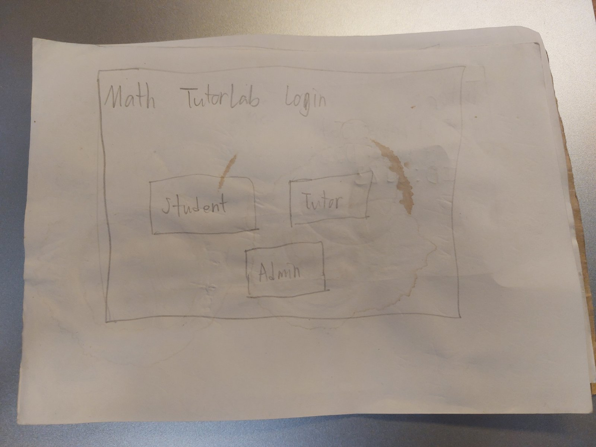
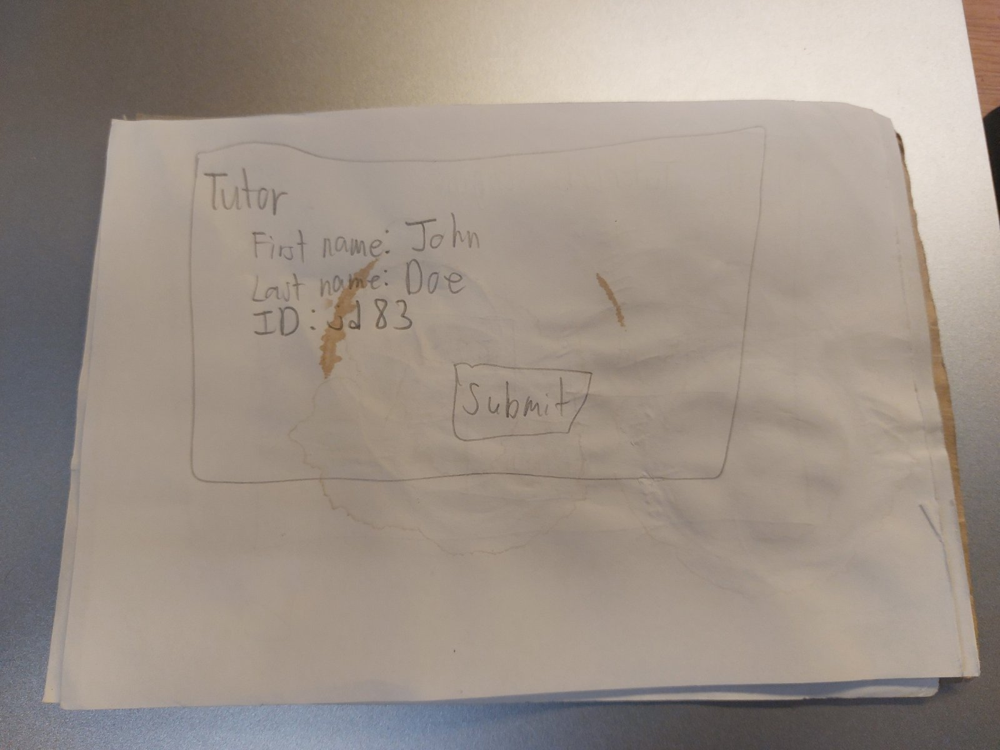
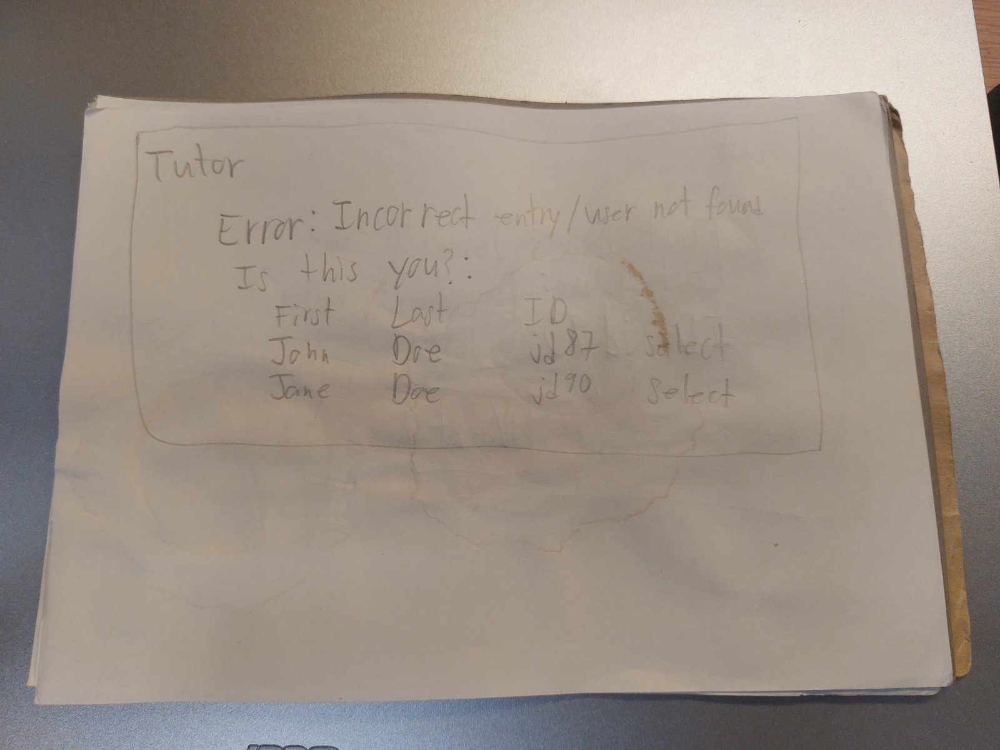
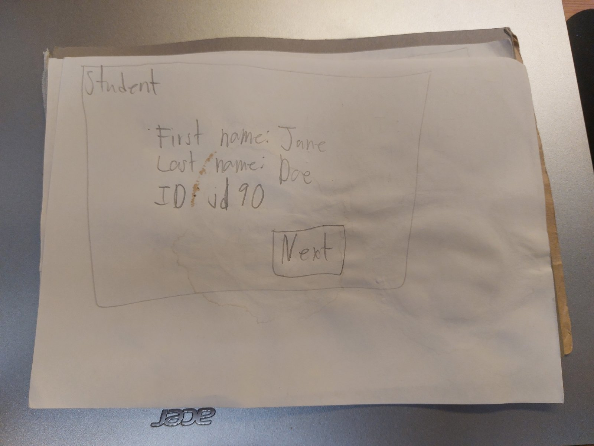
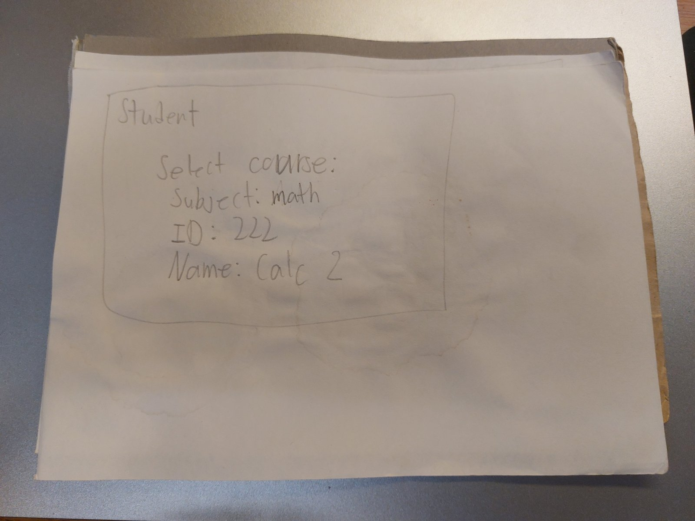
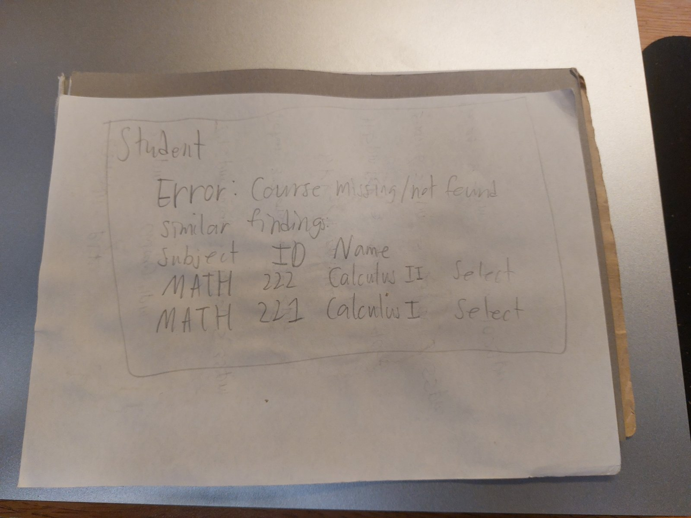

# -CS499-MathTutorLabManager
## Title: Math TutorLab Manager
The application I plan on building is a tutoring service manager that manages and records tutoring services for mathematics. In which math tutors help students struggling with mathematics, and professors can see if a student does go to tutoring or not for help, and math tutors can have their sessions of tutoring tracked so that they can get paid. The application works as a record keeper, makes sure students coming for tutoring can sign in, tutors can have the evidence they came signed, and professors can easily access this website by secure log in and see if tutors are tutoring or not, and if students in their class who struggle came in or not. It solves the problem of making record keeping digitized and clear of spelling errors and writing errors, preventing tutors from forgetting to sign and from signing the name of a friend who was not there, and allows professors to easily know who came or not without needing to pass around a sheet of paper which can easily become lost.

People would use this because it will be far more convenient and error resistant. The first problem is solves is preventing errors. People's hand writing can be terrible even if they remember to write to record their arrival. Also remembering course name and course number can be hard, so a feature to select it from searching it up can help. For tutors, it can help them easily sign up by typing their name, and ID. It makes it easy, also the computer running the website will occasionally send a ping sound to remind them to sign up. For professors it is more convenient to search up a student they are concerned about by their name or ID to see if they have been coming to turoing or not, instead of getting the several tutoring sheets and trying to read people's handwriting. As for what users will be able to do with it. The tutors can sign in to record their presence using name and ID. The students can have their presence recorded by clicking student sign in and then inputting their name and ID until it matches, then selecting a course name and its id that they came for hlp for by searching, and specifying whether or not they are an athlete. The professors using the admin login feature can see whther tutors and students are coming, and search up a student or tutor by their name or id to see their records and modify search to specific dates.

## Target Users
My target users are three types of users. One of them are mathematics tutors. They are students who are so good at mathematics the math department hired them to tutor students struggling with math. They want to easily and seemlessly get their presence recorded, and get paid with ease. Another are students. People struggling with mathematics who came to math tutoring to get help. They just want to easily get that they came and which course they came to get help with recorded easily. Lastly, the final user is professors, they want to see whether tutors are coming or not to get paid, and whether students they are concerned about are coming or not.

## Core Features
- Error detection when signing in and prevention: Both tutors and students, when signing in, can have errors detected if they type their name or ID wrong. It will list whether they meant this student full name with this ID. Making it clear which person they are.
- Course search up: When students sign in, instead of having to remember the exact course number, they can search up the course by its name. The student can also select a + button to let the application know they are coming not just for one course but for more than one.
- Reminder to sign in: Every approximately 30 minutes. The application will send out a sound, a bell sound. Not too distracting. With a pop up saying remember to sign in if you are a student to let professors know you go to tutoring, and tutors to get your work hours recorded.
- Easy search for professors: If professors want to know if a student is going to tutoring or not they can search up a student. Select them and see all records of them coming to tutoring. If they want to only see the records related to the student coming in a specific semester for their course, they can select search filters to filter it to what they are specifically looking for. 
- Doing data analysis: The data is stored in a database. Data analysis can be done with the data accumulated of students signing in.

## Project scope
Because I literally made this exac project! But in python! That is why the project is in scope. I am just fixing the user interface and making it have an actual GUI for once! The functionality I consider essential is signing in for tutors and students, and being able to verify that students and tutors came to turoing as a professor by being the only user able to access the records as an admin. The bell feature and the data analysis feature are optional, because the concern is error prevention by making it easier to search up the course and the student you are by name and selecting the one with the right name or id, and digitizing the records. I anticipate making sure the login and search feature works, and it is reliaby able to detect if a tutor or student mistyped their id or name, it will be able to pull up a screen fincing matches and asking to select the correct one. Making that work will be difficult, I anticipate that. But the best news is I did this already. In a previous course! In my databases course I made this exact thing but as a command line interface instead of a proper graphical user interface. All I need to do is translate it to react with the same database, make some additional enhancements, and im done.

## Basic sketch

## Initial Data Requirements
- Date
- Time
- Student names of both tutors and students coming for tutoring
- Student IDs
- Course names
- Course IDs
- Athlete status of students
- Professor username
- Professor password

## Current Goals (For Personal Use):
1. Review my previous tutorlab code made in python and cli interface. Understand exactly how it works. Made in database course.
2. Review my previous postgresql database for the tutorlab in database course. 
3. Plan out and understand how it all works together, and how I can make a react website interact with the same exact database but better.
4. Execute the plan, making it and testing it.
5. code review and fix bugs and errors I missed.
6. Done!